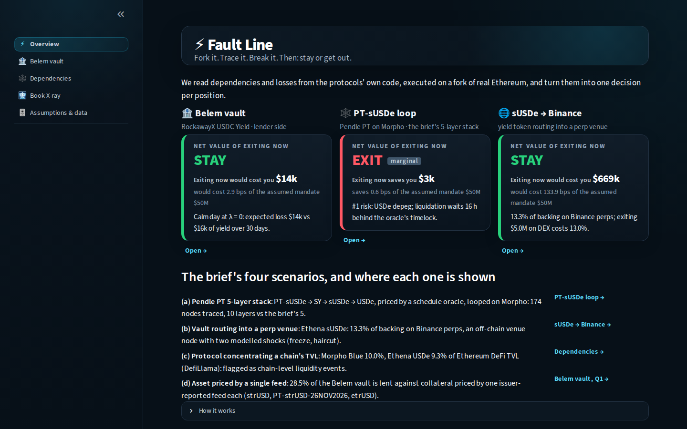
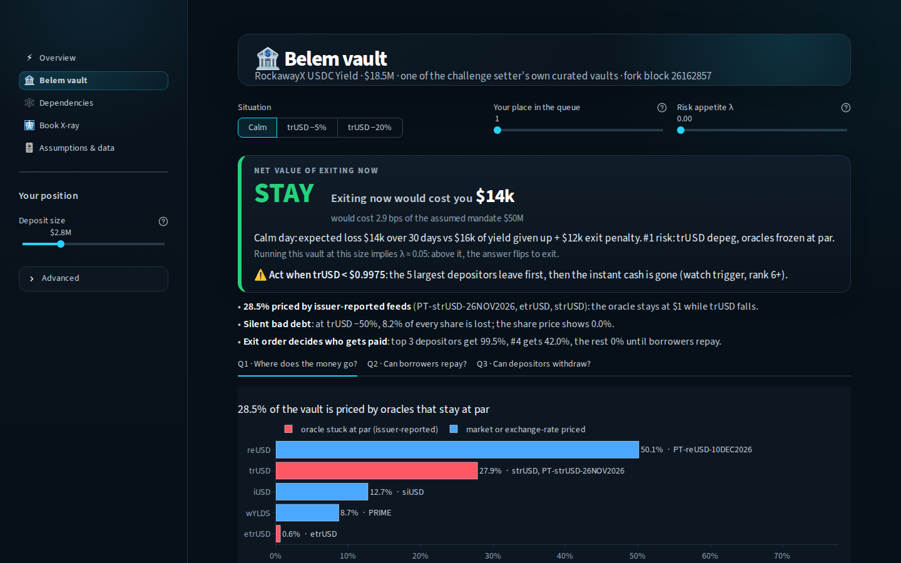
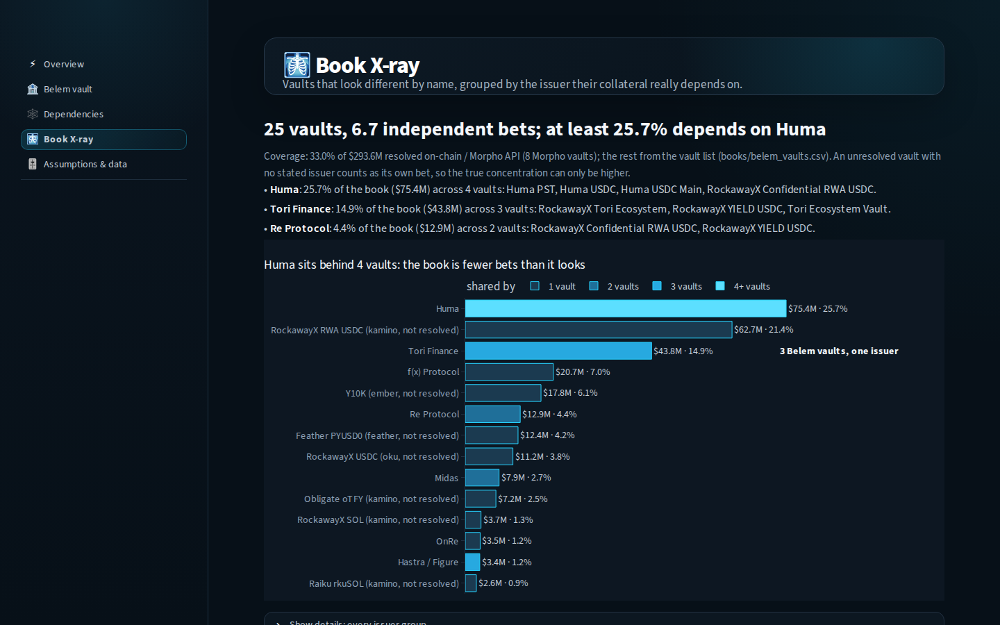
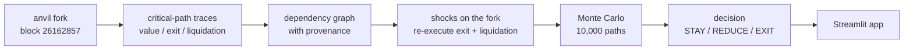

# Fault Line — Fork it. Trace it. Break it. Then: stay or get out.

Fault Line takes a DeFi position, executes its critical transactions (valuation, exit, liquidation) on an anvil
fork of Ethereum mainnet, and reads the dependency graph from the traces: contracts called, storage slots read,
proxies, admins, oracles and the feeds behind them. It then breaks those dependencies on the fork (oracle moves,
depegs, liquidity withdrawals, NAV markdowns, a run on the vault), re-executes the exit and the liquidation, and
turns the measured losses into one decision per position: **net value of exiting now** = risk-adjusted loss
avoided − yield given up − measured exit cost, with STAY / REDUCE / EXIT. It is demonstrated on the challenge
setter's own book: the Belem / RockawayX curated vaults, at fork block **26162857**.

| Overview | Belem vault | Book X-ray |
|---|---|---|
|  |  |  |

## Key findings (fork block 26162857)

- **RockawayX USDC Yield vault** (`0xe018…1965`, $18.5M, 6 markets). On a calm day the answer is **STAY**: for the
  default $2.78M deposit, exiting now would cost $14k (2.9 bps of the assumed $50M mandate). That holds only for a
  risk-neutral holder: running this vault at this size **implies λ ≈ 0.05** (0.054). **28.5%** of the vault is lent
  against strUSD, PT-strUSD and etrUSD, priced by issuer-reported feeds that stay at par. With the oracle pinned
  on the fork at trUSD −50%, **8.2% of every share is lost and the share price shows 0.0%** (silent bad debt).
- **Bank run on the same vault**, executed on the fork with the real top depositors: **only the first 3 get out**
  (99.5% each), #4 gets 42.0% and everyone after gets 0% until borrowers repay. At trUSD −20%, rank 5 reads
  QUEUE EXIT NOW, with 14.3% back within 24 h. Watch trigger: act when trUSD < $0.9975.
- **PT-sUSDe on Morpho** (the brief's 5-layer stack): the traces found **10 layers** (174 nodes, 355 edges, an
  8-level asset stack). The lending oracle is a **fixed linear-discount schedule** that cannot see a PT or USDe
  crash; the MetaOracle switches to its backup only after a **16 h challenge timelock** (the loop is liquidated
  on the fork at USDe −25%). Morpho Blue and Ethena hold 10.0% and 9.3% of Ethereum DeFi TVL. Result: EXIT,
  marginal (+$3k, 0.6 bps), on a $162k position capped at 10% of the $3.8M Pendle pool.
- **sUSDe → Binance perps**: 13.3% of Ethena's $4.79B backing sits on Binance; the $62.1M reserve fund absorbs a
  Binance haircut up to 9.7%. **STAY**: exiting $5M would cost $669k because of a **DEX depth wall**: 0.1% at
  $1.25M (live quote), 13.0% at $5M (executed on the fork).
- **Book X-ray** of the 25 Belem / RockawayX vaults with TVL ($293.6M): **6.7 independent bets**, and **at least
  25.7% depends on Huma** (4 vaults); Tori Finance sits behind 3 vaults (14.9%).

## How Fault Line answers the brief

| Criterion / scenario | Where it is implemented | Where it is shown |
|---|---|---|
| Dependency discovery (30%) | `discovery/hero1.py`, `hero2.py`: callTracer + prestateTracer on the fork, recursive proxy / admin / Safe / timelock resolver, interface probing (`classify.py`), provenance on every node and edge, oracle feed quality (`oracle_quality.py`), TVL concentration (`tvl.py`) | Dependencies: graph, layers chart, node inspector with provenance; Belem vault Q1 |
| Defensible impact (30%) | `risk/fork_shocks.py`, `scenarios_hero1.py`, `scenarios_hero2.py`: shocks applied to fork state, exit and liquidation re-executed; `risk/engine.py`: response surfaces + Monte Carlo on base rates from `risk/base_rates.py` | Belem vault Q2; Dependencies → Break it; Assumptions & data (base rates) |
| Stay / exit decision (25%) | `risk/engine.py` (decision rule, breakeven, tornado), `risk/exit_race.py` (lender-side exit race), `decision/hero1.py`, `hero2.py`, `hero3.py` | Headline card on every page; Belem vault Q3, implied λ, early warning |
| Working demo on real data (15%) | Fixed fork block 26162857; every RPC / API response cached in `data/cache/`, so the app runs offline | All pages; `streamlit run app/main.py` |
| (a) Pendle PT 5-layer stack | `discovery/hero1.py`, `risk/scenarios_hero1.py` | Dependencies → PT-sUSDe loop |
| (b) Vault routing into a perp venue | `decision/hero3.py` (Ethena sUSDe → Binance, off-chain venue node, freeze + haircut shocks) | Dependencies → sUSDe → Binance |
| (c) Protocol concentrating a chain's TVL | `discovery/tvl.py` (DefiLlama share of chain TVL) | Dependencies findings; Overview |
| (d) Asset priced by a single feed | `discovery/oracle_quality.py` (issuer-reported / fixed-schedule / single-feed flags) | Belem vault Q1; red borders in the graph |

## Quickstart

### Offline demo (no RPC, no keys)

Every result the app needs is committed (`data/`), so a fresh clone runs as is. Python 3.12.

```bash
git clone https://github.com/Acheline/fault-line.git
cd fault-line
python3 -m venv .venv
source .venv/bin/activate
pip install -r requirements.txt
streamlit run app/main.py          # opens http://localhost:8501
```

- **Windows**: use WSL (Ubuntu) and run the commands above in the WSL terminal.
- **Mac**: the same commands in Terminal (install Python 3.12 first, e.g. `brew install python@3.12`).

"Break it" replays the cached fork run when no fork is running.

### Live mode (re-run on a fork)

```bash
curl -L https://foundry.paradigm.xyz | bash && foundryup      # installs anvil / cast
cp .env.example .env                                          # fill in ETH_RPC_URL, ETHERSCAN_API_KEY
set -a; source .env; set +a
anvil --fork-url "$ETH_RPC_URL" --fork-block-number 26162857 --auto-impersonate
```

With anvil running on `127.0.0.1:8545`, "Break it" executes the shock on the fork (this mutates the fork state;
restart anvil for a clean state).

### Re-running the pipelines

Each writes into `data/` and caches every call; add `--offline` to replay from the cache (all except the two
`decision.*` steps, which need a running fork).

```bash
python -m core.book_builder         # assumed 10-pocket book, verified on-chain -> books/belem_assumed_book.yaml
python -m discovery.hero1           # PT-sUSDe traces + resolver -> data/graphs/hero1.json
python -m discovery.hero2           # RockawayX USDC Yield: Q1-Q3 -> data/graphs/hero2.json
python -m discovery.pockets         # graphs for the other pockets
python -m risk.liquidity_recovery   # Morpho 100%-utilization episodes (refill speed)
python -m risk.base_rates           # probabilities from data -> data/base_rates.json
python -m risk.scenarios_hero1      # fork shocks, hero #1 -> data/shocks/hero1.json
python -m risk.scenarios_hero2      # fork shocks, hero #2 -> data/shocks/hero2.json
python -m decision.hero2            # governance run + realized APY -> data/headline/ (needs the fork)
python -m decision.hero3            # Ethena API + fork exit (needs the fork and network)
python -m discovery.xray            # shared ancestors across the 10 pockets
python -m discovery.book_xray       # shared issuers across the 25 Belem / RockawayX vaults
```

## How it works



1. **Discover.** For each position, the valuation call, the exit route (e.g. PT → sUSDe → USDC via Pendle +
   Kyber, or `redeem()` as a real top depositor) and a liquidation are traced with `callTracer` and
   `prestateTracer`. Touched addresses are resolved recursively (EIP-1967 proxies, admins, Safe owners, timelocks,
   MetaMorpho / Vault V2 roles and queues) and classified by interface. Every node and edge records where it came
   from (trace, storage read, API, registry, disclosure), the block and a confidence.
2. **Break.** Shocks are written into fork state (oracles pinned by replacing their code, LP withdrawals by impersonated LPs,
   NAV markdowns, frozen oracles, the curator's own `forceDeallocate` penalty) and the exit and liquidation are
   re-executed. Each run gives a measured loss per $ (loss per vault share, liquidation yes/no, penalty, bad
   debt); a monotone response surface is fitted through the measured points.
3. **Decide.** Monte Carlo: 10,000 paths (seed 7), 30-day horizon, driver occurrences coupled by a one-factor
   Gaussian copula (ρ = 0.3, assumption), probabilities and severities from computed base rates. Output: expected
   loss, worst-case average (CVaR95), attribution, breakeven belief, tornado. Decision rule, over exit fractions
   x ∈ {0, 25, 50, 75, 100%} and times t ∈ {now, 15 min, 1 h, 6 h, 24 h}:

   `net(x, t) = [E[L] + λ·(CVaR95 − E[L])] · exited$ · remaining horizon − yield given up − C_exit(x, t)`

   **Exit race (lender side):** t = 0 is measured on the fork (depositors redeem in size order, each draining the
   liquidity the next one can reach); after that, liquidity refills at the median rate measured in 29 past
   100%-utilization episodes on Morpho, and the vault only gets its pro-rata share.

## What is measured, computed, modelled or assumed

| Kind | Examples | Source |
|---|---|---|
| Measured on the fork | traces and graph, vault roles and queues, market allocations, borrower health factors, exit quotes executed through Pendle / Kyber, losses per share under each shock, the bank run, the curator penalty run | anvil fork at block 26162857 (`data/cache/`) |
| Computed from data | exploit rates by protocol type / age / TVL, depeg frequency and depth, NAV markdowns, oracle staleness, liquidity refill speed, TVL shares | DefiLlama (hacks, protocols, stablecoin prices), Morpho GraphQL API, on-chain event history |
| Modelled from disclosure | off-chain layers: Ethena hedge and custodians, CEX venues, RWA issuers' backing; Binance freeze and haircut shocks | public disclosures and the Ethena API, tagged `offchain_disclosed` with a link |
| Assumed (pending Belem confirmation) | $50M mandate, ~$400M AUM, λ, ticket sizes and venue caps, exit tranches, budgets, ρ, horizon | `ASSUMED_ANSWERS.md` (questions in `QUESTIONS.md`); every value has a slider on the Assumptions & data page |

## Limitations

- **Book coverage:** the 8 Morpho vaults (33.0% of the book's TVL) are resolved on-chain; the other vaults
  (Kamino, Upshift, Ember, Feather, Oku, Midas, …) are TVL-level only, from `books/belem_vaults.csv`.
- **Off-chain venues are modelled, not executed:** a Binance freeze or haircut is parametric (venue share from
  the Ethena API, incident rates from 3 CEX incidents over 47.9 venue-years).
- **Small samples for some base rates.** Yield-backed synthetic dollars collapsing below $0.50: 5 events in 23.2
  coin-years, 21.6%/yr (90% range 8.5%–45.3%); at the high end the calm-day answer at λ = 0 changes from STAY to
  REDUCE. reUSD NAV markdowns > 1%: 15 in 15.8 coin-years (58.6%–146.3%/yr). PRIME NAV: 165 days of history, 2
  decreases, none above 1%. The Base rates section and the vault page's "What moves the decision" show the ranges.
- **Some exit sizes are quote-only:** the sUSDe unstake-then-sell route (3.4% at $5M) and the $1.25M / $5M live
  Kyber quotes were not executed on the fork.
- **Rate limits:** built against an Alchemy free-tier RPC; full pipeline re-runs are slow, which is why every
  response is cached and the demo runs from the cache.
- **Fixed fork block:** all results are at block 26162857; allocations and prices change. Not built from the
  original plan: the historical-incident replay ("time machine") and a watch-mode loop (the early-warning trigger
  is computed, but nothing polls new blocks).

## Repo layout

```
app/        Streamlit UI: Overview, Belem vault, Dependencies, Book X-ray, Assumptions & data
books/      vault registry (belem_vaults.csv) and the assumed 10-pocket book (YAML)
core/       fork client (cached calls / traces), addresses, config, schemas, book builder
data/       committed results: graphs, shocks, headlines, base rates, X-rays, and the RPC / API cache
decision/   per-position headline: decision rule applied to the cached fork measurements
discovery/  tracing, resolver, classifier, oracle quality, TVL, X-rays, graph renderer
docs/img/   README screenshots
output/     exported standalone graph HTML
risk/       fork shocks, scenarios, base rates, Monte Carlo engine, exit race
tests/      pytest suite
```

## Tests

```bash
python -m pytest -q --ignore=tests/smoke_test.py    # 40 tests, offline, from the committed data
python -m pytest -q tests/smoke_test.py             # needs anvil running on 127.0.0.1:8545
```

Covered: discovery on hero #1 finds the Pendle market, SY, sUSDe / USDe, the Morpho oracle, its feeds and the
proxy admins; discovery on hero #2 finds every market in the vault's queues, their oracles and collateral, and
the vault's roles; the Monte Carlo is deterministic and the decision rule reproduces the brief's 10 pockets × 10% / 11% case; the
X-ray finds the shared Ethena dependency without it being configured; config, book, base rates, decision layers
and the collapsed graph. The discovery tests rewrite `data/graphs/` and `output/` with set-order changes only
(`git checkout -- data/graphs output` to discard).

## Team

- **[Name]**: back-end (fork pipeline, tracing, shock simulations, risk engine)
- **[Name]**: front-end (Streamlit app, dependency graph, charts, Break it)
